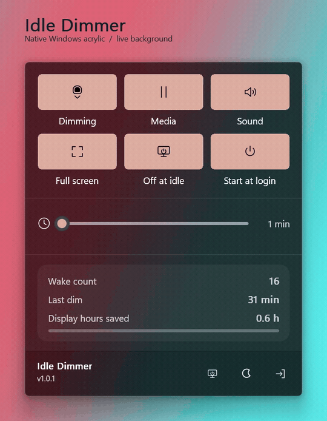

# Idle Dimmer

App version: **1.0.1**.

[](https://github.com/Saderius/idle-dimmer/actions/workflows/build.yml) [](LICENSE) [](IMPLEMENTATION.md)

**Dims your screen to black after two minutes of no input — not off, just dark — and restores your
brightness instantly on any touch, key, click, or pen stroke.**



Recorded from the running app over a moving colour background, showing how the native
acrylic responds. [Watch the MP4 for smoother gradients](docs/media/acrylic-demo.mp4).

No installer, no runtime, no network. A native Win32 executable and a tray icon.

---

## Why not just turn the display off?

Because turning the panel off is a much heavier operation than it looks:

| | Display off | Idle Dimmer |
|---|---|---|
| Session stays live | no — the desktop is torn down and rebuilt | **yes** |
| Wake latency | visible flicker while the panel re-syncs | **none**, brightness is a single WMI call |
| Full-screen video | interrupted | **paused protection**, or untouched |
| OLED / e-ink panels | panel-off transitions are the visible artefact | brightness ramps down |
| Cost at idle | power-plan timer wakes | **one wake per idle period** |

The app sets the panel's hardware brightness to 0% instead of powering it down. The machine keeps
running, the GPU keeps its surface, and the restore is immediate rather than a wake-up sequence.

## What it does

- **Idle dimming** — hardware brightness to 0% after a configurable 1–60 minute threshold
  (default 2). Internal panels go through WMI; external monitors go through DDC/CI, the same
  mechanism Twinkle Tray uses. Restores your exact previous level on the first input of any kind.
- **Displays off** — optional second stage: `OffMinutes=N` switches the displays to standby `N`
  minutes after the dim, `OffInsteadOfDim=1` goes straight to standby at the idle threshold with
  no dim at all, and the footer's monitor button does it on demand. Standby is the only state that
  stops the backlight entirely, so it ages the panel less than 0% brightness does
  (`IMPLEMENTATION.md` §5.1). Any input wakes the screens and restores the brightness.
- **Protection toggles** — pauses while media is playing, and while a full-screen app is up.
  Media detection uses Windows' media session list first, then falls back to "an application is
  rendering audio", so a browser that publishes no media session (media keys disabled) still
  protects playback.
- **Native acrylic panel** — Windows composition renders the desktop material behind transparent
  controls. The renderer starts on open and shuts down on hide, with no hidden panel worker or
  refresh timer. In dark mode, a subtle brighter main surface and dark divider distinguish the
  ribbon below. **Live review, 2026-11-02:** the user described the completed revision as
  "generally great!"; exact ribbon colour matching has not been separately measured.
  `Acrylic=0` selects the opaque panel.
  Native startup failures use the prior software fallback; `--status` reports the reason.
- **Native upward entrance** — the complete window stays cloaked during GPU upload and composition preparation,
  then Windows Animation Manager slides its frame, material, and controls up together from behind
  the taskbar. Closing reverses the motion; the native timer is disabled at rest and released on hide.
  Respects Windows' animation preference and tears down on hide. **Implementation update, 2026-11-02:**
  re-entrant `ShowPanel` invocations are guarded, positioning updates route through `kAnimationUpdateMessage`
  on the UI thread, and the flyout is ordered behind the target monitor's taskbar. **USER-REVIEWED
  2026-11-02:** "generally great!" on the running revision. Exact native visual parity remains
  **UNVERIFIED**. The mechanism is documented in `IMPLEMENTATION.md` section 9.1; temporary
  presentation tracing was removed during cleanup on 2026-11-02.
- **Sunset tray icon** — the sun in the tray descends toward the horizon as idle time accrues, so
  you can see how close the next dim is without opening anything.
- **Five tray designs**, live previews, remembered across restarts.
- **Start with Windows** — a Run-key entry, no service, no scheduled task, no admin rights.
- **Crash-safe** — the pre-dim brightness is written to disk before dimming, so a hard reset does
  not leave you at 0%.
- **Never touches your input** - idle time comes from Windows' own `GetLastInputInfo` counter. The  app cannot see what you type, and raw-input notifications are only registered *while* dimmed.
- **Screenshots work normally with native acrylic.** The desktop backdrop stays in Windows composition; the app does not capture it. The software live fallback can be frozen with `--acrylic-pause`; `--panel-shot` renders software fallback only. The app registers no global keyboard shortcuts.

## Install

1. Download the zip from [Releases](../../releases) and extract it anywhere.
2. Run `IdleDimmer.exe`. The tray icon appears — check the `^` overflow area.
3. Optionally turn on **Start with Windows** in the panel.

> **SmartScreen:** the executable is not code-signed, so Windows will show *"Windows protected your
> PC"* on first run. Choose **More info → Run anyway**. Signing certificates cost more than this
> utility is worth; the source is here if you'd rather build it yourself.

## Updates and releases

Download updates from [GitHub Releases](https://github.com/Saderius/idle-dimmer/releases).
Quit the running app normally so it restores brightness, then replace only `IdleDimmer.exe`.
Keep your settings and statistics files. Each new release includes SHA-256 checksums for
the EXE and ZIP. In-app update checking and installation are planned separately.

Releases are prepared deliberately from a chosen snapshot of `main`; ordinary commits only
run build checks. The **Prepare release** workflow builds and tests the app, creates the
downloads, and generates a draft with highlights and a complete commit list. A draft becomes
public only when published, so the source version above can be newer than the latest download.
See [the release guide](docs/RELEASING.md) to prepare a version or delegate it to a coding agent.

## The panel

Click the tray icon — left or right, there is only one UI — to open Quick Settings:

- **Dimming** — master switch. Also holds the display awake so the app owns dimming instead of the
  power plan.
- **Idle slider** — 1–60 minutes, every minute the same distance apart, with invisible magnetic
  presets at 1 / 2 / 5 / 10 / 15 / 30 / 60. Scroll over the slider row to adjust by one minute
  per notch: up increases the delay, down decreases it. Changes save automatically.
- **Media** / **Sound** / **Full screen** — the three protection toggles. Media uses Windows' media
  session list (knows paused, names the player); Sound uses "this app is rendering audio", which
  also catches players that publish no session.
- **Off at idle** — switch the displays off at the threshold instead of dimming them.
- **Start at login** — the autostart Run-key entry.
- **Power card** — wake count, last dim, and estimated display hours saved, persisted across runs.
- **Footer** — turn the displays off after a five-second settling delay (monitor icon),
  dim immediately (crescent), or quit, restoring brightness first.

The panel never takes keyboard focus. It is created `WS_EX_NOACTIVATE`, so it cannot steal the caret
from whatever you are typing in, and it closes on click-away or Escape without swallowing the click.

## Settings

`settings.ini`, written next to the executable:

```ini
[Settings]
Enabled=1
ProtectMedia=1
ProtectSound=1
ProtectFullscreen=1
IdleMinutes=2
Icon=4
OffMinutes=0
OffInsteadOfDim=0
Acrylic=1
```

`OffMinutes` is the displays-off delay after a dim: `0` never switches them off (the default),
`1`–`60` switches them to standby that many minutes after the brightness reaches 0%.
`OffInsteadOfDim=1` skips the dim and switches the displays off at the idle threshold instead
(`OffMinutes` is then unused). Out-of-range values are clamped. `brightness-recovery.bin` and `ddc-recovery.bin` hold the crash-recovery
brightness, and `activity.log` records dim, restore and displays-off events only — no keys, no
screen content, no network.

## Efficiency

This is the whole point of the project, so it is measured rather than asserted:

- One coalescable timer, set to wake **when a decision actually becomes possible** — not on a fixed
  poll. Roughly one wake per idle period instead of two per minute.
- While dimmed, the raw-input sink catches input with no timer involved at all.
- WMI brightness calls happen only at dim and restore, never on a wake tick.
- No panel worker threads while hidden. The UI thread sleeps in the kernel while idle.

Current figures and how they were obtained: [`IMPLEMENTATION.md` §15](IMPLEMENTATION.md). Some older
numbers in the git history are marked stale on purpose.

## Build

Requires nothing but PowerShell and the bundled Zig toolchain in `build-tools\`:

```powershell
powershell -NoProfile -ExecutionPolicy Bypass -File build.ps1
```

The build rasterizes the panel SVGs into alpha masks, compiles with `-Os` and section GC, embeds the
application icon, and then runs two gates that **fail the build**:

- `tools\measure-icons.ps1` — icon geometry, because off-centre glyphs are invisible in code review
  and obvious in the tray.
- `tools\check-docs.ps1` — every mechanism in the code must be documented, every user-visible status
  string must be accounted for, and no stale claim may survive.

```powershell
.\IdleDimmer.exe --self-test   # MEASURED 2026-11-02: PASS, 2368 checks; not visual certification
```

## Command line

| Flag | Effect |
|---|---|
| `--enable` | start dimming in an already-running instance |
| `--quit` | graceful exit, restoring brightness first |
| `--status` | write the runtime report to `diagnostics.txt` |
| `--menu` | open or close the panel |
| `--self-test` | run the assertion suite |
| `--diagnose` | report media API (sessions and the audio fallback, separately), brightness API, panels, autostart, threshold |
| `--test-brightness` | one full dim/restore cycle with a pass/fail report |
| `--autostart` | silent start, used by the Run-key entry |

## Documentation

- [`IMPLEMENTATION.md`](IMPLEMENTATION.md) — the technical reference: architecture, the adaptive
  scheduler, the panel's paint path, failure handling, and every measured number with its date.
- [`AGENTS.md`](AGENTS.md) — the engineering rules this repo was built under, including the
  verification failures that produced them.
- [`docs/research/`](docs/research) — Win32 research on full-screen detection, GPU activity signals,
  and non-interactive sessions.
- [`docs/RELEASING.md`](docs/RELEASING.md) — deliberate release builds, generated notes, downloads,
  checksums and publication.

## License

[MIT](LICENSE).

**USER-CONFIRMED 2026-11-02:** after the monitor-loop fix, the user reported that manual
off/wake behavior generally works correctly on the running desktop build. Manual off bypasses
brightness access, settles before one OS power request, and waits for fresh meaningful input.
Its pending/off session pauses ordinary idle/media decisions. Temporary transition logging was
removed before committing. Surface and broader hardware compatibility remain unverified.
`build.ps1 -NoRun` builds without executing or relaunching the app. See IMPLEMENTATION.md
section 5.1 and `docs/research/2026-11-02-display-off-loop.md`.
