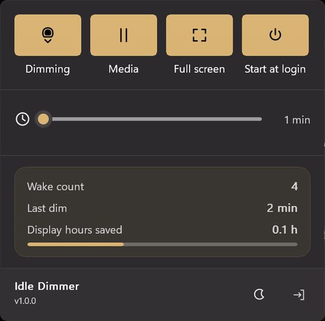

# Idle Dimmer

[](https://github.com/Saderius/idle-dimmer/actions/workflows/build.yml) [](LICENSE) [](IMPLEMENTATION.md)

**Dims your screen to black after two minutes of no input — not off, just dark — and restores your
brightness instantly on any touch, key, click, or pen stroke.**



No installer, no runtime, no network. One 202 KB Win32 executable and a tray icon.

---

## Why not just turn the display off?

Because turning the panel off is a much heavier operation than it looks:

| | Display off | Idle Dimmer |
|---|---|---|
| Session stays live | no — the desktop is torn down and rebuilt | **yes** |
| Wake latency | visible flicker while the panel re-syncs | **none**, brightness is a single WMI call |
| Full-screen video | interrupted | **paused protection**, or untouched |
| OLED / e-ink panels | panel-off transitions are the visible artefact | brightness ramps down |
| Cost at idle | power-plan timer wakes | **one wake per idle period** |

The app sets the panel's hardware brightness to 0% instead of powering it down. The machine keeps
running, the GPU keeps its surface, and the restore is immediate rather than a wake-up sequence.

## What it does

- **Idle dimming** — hardware brightness to 0% after a configurable 1–60 minute threshold
  (default 2). Restores your exact previous level on the first input of any kind.
- **Protection toggles** — pauses while media is playing, and while a full-screen app is up.
- **Sunset tray icon** — the sun in the tray descends toward the horizon as idle time accrues, so
  you can see how close the next dim is without opening anything.
- **Five tray designs**, live previews, remembered across restarts.
- **Start with Windows** — a Run-key entry, no service, no scheduled task, no admin rights.
- **Crash-safe** — the pre-dim brightness is written to disk before dimming, so a hard reset does
  not leave you at 0%.
- **Never touches your input** — idle time comes from Windows' own `GetLastInputInfo` counter. The
  app cannot see what you type, and raw-input notifications are only registered *while* dimmed.

## Install

1. Download the zip from [Releases](../../releases) and extract it anywhere.
2. Run `IdleDimmer.exe`. The tray icon appears — check the `^` overflow area.
3. Optionally turn on **Start with Windows** in the panel.

> **SmartScreen:** the executable is not code-signed, so Windows will show *"Windows protected your
> PC"* on first run. Choose **More info → Run anyway**. Signing certificates cost more than this
> utility is worth; the source is here if you'd rather build it yourself.

## The panel

Click the tray icon — left or right, there is only one UI — to open Quick Settings:

- **Dimming** — master switch. Also holds the display awake so the app owns dimming instead of the
  power plan.
- **Idle slider** — 1–60 minutes, every minute the same distance apart, with invisible magnetic
  presets at 1 / 2 / 5 / 10 / 15 / 30 / 60.
- **Media** / **Full screen** — the two protection toggles.
- **Start at login** — the autostart Run-key entry.
- **Power card** — wake count, last dim, and estimated display hours saved, persisted across runs.
- **Footer** — open the app folder, quit (which always restores brightness first).

The panel never takes keyboard focus. It is created `WS_EX_NOACTIVATE`, so it cannot steal the caret
from whatever you are typing in, and it closes on click-away or Escape without swallowing the click.

## Settings

`settings.ini`, written next to the executable:

```ini
[Settings]
Enabled=1
ProtectMedia=1
ProtectFullscreen=1
IdleMinutes=2
Icon=4
```

Out-of-range values are clamped. `brightness-recovery.bin` holds the crash-recovery brightness, and
`activity.log` records dim and restore events only — no keys, no screen content, no network.

## Efficiency

This is the whole point of the project, so it is measured rather than asserted:

- One coalescable timer, set to wake **when a decision actually becomes possible** — not on a fixed
  poll. Roughly one wake per idle period instead of two per minute.
- While dimmed, the raw-input sink catches input with no timer involved at all.
- WMI brightness calls happen only at dim and restore, never on a wake tick.
- No worker threads. The thread sleeps in the kernel while idle.

Current figures and how they were obtained: [`IMPLEMENTATION.md` §15](IMPLEMENTATION.md). Some older
numbers in the git history are marked stale on purpose.

## Build

Requires nothing but PowerShell and the bundled Zig toolchain in `build-tools\`:

```powershell
powershell -NoProfile -ExecutionPolicy Bypass -File build.ps1
```

The build rasterizes the panel SVGs into alpha masks, compiles with `-Os` and section GC, embeds the
application icon, and then runs two gates that **fail the build**:

- `tools\measure-icons.ps1` — icon geometry, because off-centre glyphs are invisible in code review
  and obvious in the tray.
- `tools\check-docs.ps1` — every mechanism in the code must be documented, every user-visible status
  string must be accounted for, and no stale claim may survive.

```powershell
.\IdleDimmer.exe --self-test   # 2029 decision, layout, and pixel assertions
```

## Command line

| Flag | Effect |
|---|---|
| `--enable` | start dimming in an already-running instance |
| `--quit` | graceful exit, restoring brightness first |
| `--status` | write the runtime report to `diagnostics.txt` |
| `--menu` | open or close the panel |
| `--self-test` | run the assertion suite |
| `--diagnose` | report media API, brightness API, panels, autostart, threshold |
| `--test-brightness` | one full dim/restore cycle with a pass/fail report |
| `--autostart` | silent start, used by the Run-key entry |

## Documentation

- [`IMPLEMENTATION.md`](IMPLEMENTATION.md) — the technical reference: architecture, the adaptive
  scheduler, the panel's paint path, failure handling, and every measured number with its date.
- [`AGENTS.md`](AGENTS.md) — the engineering rules this repo was built under, including the
  verification failures that produced them.
- [`docs/research/`](docs/research) — Win32 research on full-screen detection, GPU activity signals,
  and non-interactive sessions.

## License

[MIT](LICENSE).
