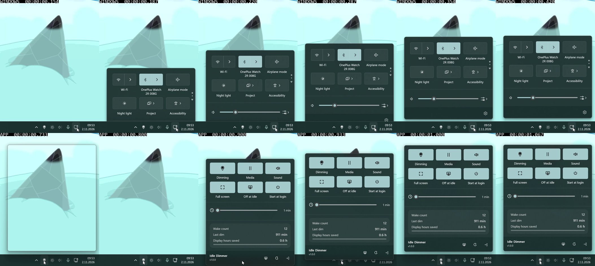
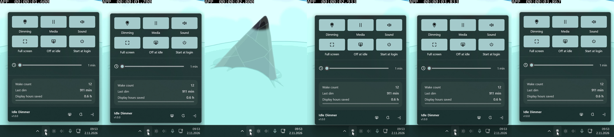

# Flyout animation: Windows versus Idle Dimmer

Observed and measured 2026-11-02 from the user's supplied recordings. This records the **pre-fix
build**, including its source and trace snapshot; references to the current implementation below
belong to that snapshot, not the subsequent revision.

**Implementation follow-up — USER-REVIEWED 2026-11-02:** the resulting Gemini implementation and
parent review were deployed, and the user responded "okay, generally great!". The overall
improvement is positively reviewed; exact native parity and the precise cause of the earlier
late displacement are not established by that verdict. Current mechanisms and validation are in
[IMPLEMENTATION.md section 9.1](../../IMPLEMENTATION.md#91-panel-window-focus-and-click-away-dismissal).

The recordings show presentation faults beyond the choice of easing curve. Windows presents a
populated panel emerging behind the taskbar. Idle Dimmer exposes an empty frame, loses that frame,
then presents and moves the populated panel over the taskbar. The app also visibly changes position
after holding still. Code and trace evidence explain several contributing mechanisms, but do not
yet identify the exact cause of every late on-screen displacement.

## Evidence and method

- App: `20261102-0854-46.2597153.mp4`.
- Windows: `20261102-0855-13.5112876.mp4`.
- The user also supplied an empty-frame screenshot and two populated-panel screenshots showing
  different resting positions. Their image sizes/crops differ slightly, so displacement figures
  below come from the original video, not a direct subtraction of the screenshots.
- MEASURED 2026-11-02 with ffprobe: both videos are 702 by 944 pixels and report a nominal
  30 frames per second. App duration is approximately 5.227 seconds; Windows approximately
  1.365 seconds. Measurements below use each decoded frame's presentation timestamp, not an
  assumed recording-start/input time. The Windows timestamps have an initial short interval.
- Extracted frames were inspected visually. A supplementary pixel check follows the continuous
  dark body inside the left margin at x=70. Its top/bottom values describe that sampled body,
  not the external shadow or exact rounded corner. Frame sampling limits timing precision to
  roughly one recorded frame; these clips cannot establish the display's actual refresh cadence.
- The live `presentation-trace.log` was read locally, along with the current source. Recording
  timestamps have not been synchronized to the log's wall clock. Trace sequences below are
  evidence from the same development session, not asserted frame-to-event synchronization.

## Comparison

| Aspect | Windows recording | Idle Dimmer recording | Assessment |
|---|---|---|---|
| First visible state | By approximately 0.187 s, the visible portion already contains the material, tiles, and labels. | Empty full-height outline at approximately 0.733–0.767 s, desktop again at approximately 0.800–0.867 s, populated panel at approximately 0.900 s. | A reveal/disappear/reveal sequence, not one coherent entrance. No solid, fully populated first flash is required to explain the user's impression: the empty full-size shell is visible first. |
| Taskbar relationship | The taskbar remains visible in front of the rising panel. The lower part of the flyout emerges from behind it. | At approximately 0.900–0.967 s, the populated panel/footer overlaps the taskbar and its icons. | The app lacks the reference's occlusion behavior. Moving a topmost HWND downward is insufficient. |
| Frame and contents | No separate empty outline is visible before the populated surface in the supplied clip. | DWM frame/shadow appears before the app's material and controls; it disappears before their entrance. | The outline is part of the HWND, while the material/controls are another composition target. Their presentation is not coordinated. |
| Visible rise | Sampled body top moves upward from y=484 at 0.187 s toward y=254 at 0.420 s. | Sampled body top moves from y=184 at 0.900 s to y=145 at 0.933 s, y=88 at 1.000 s, and y=84 at 1.067 s. Some consecutive recorded frames repeat a position. | Both move upward, but their size, travel, and observed phase differ. This is not sufficient evidence to tune a matching curve or infer shell constants. |
| Settling | Sampled body top holds at y=254 through the resting portion. | First opening holds at y=84, then moves down to y=93 at 1.700 s. Later, the body holds at y=106 from 2.933 through 3.833 s, then jumps up to y=84 at 3.867 s. | The late displacement is real in the original clip, independent of screenshot crop differences. Input/exit timing must be correlated before classifying every displacement as an entrance-completion bug. |
| Overall sequence | One populated upward reveal, followed by a stable resting surface in the opening segment. | Empty shell, disappearance, populated rise, and inconsistent later positions. | Fix ordering and presentation ownership before tuning duration/easing. |

All timestamp/coordinate figures in the table are **MEASURED 2026-11-02 from the supplied clips**.
The approximately 233 ms Windows visible-rise interval and approximately 167 ms app populated-rise
interval are observations between selected recorded states, not API durations or click latency.

## Why the implementation produces these symptoms

### Reentrant opening and renderer replacement: strong evidence

The trace contains consecutive `ShowPanel begin` events before the first native initialization
has returned, on the same UI thread. A representative sequence, **MEASURED 2026-11-02**, is:

| Local trace time | Event | Window top |
|---|---|---|
| 09:53:46.072 | `ShowPanel begin`, then another `ShowPanel begin` | 1465 |
| 09:53:46.088 | Native renderer starts | 1297 |
| 09:53:46.204 | Renderer revealed; entrance scheduled | 1465 |
| 09:53:46.205 | Window moved back to resting geometry | 1297 |
| 09:53:46.216 | Native renderer stopped while visible/entering | 1297 |
| 09:53:46.232 | Replacement renderer starts | 1297 |
| 09:53:46.352 | Replacement revealed; entrance scheduled again | 1465 |
| 09:53:46.386 | Replacement's first native motion update | 1465 before queued move |

This establishes overlapping opening work and a visible renderer replacement. It is a concrete
explanation for the extra shell/reveal sequence, beyond merely choosing a poor animation curve.

The current tray handler records `lastToggleCode` and `lastToggleAt` **after** calling
`TogglePanel` (`IdleDimmer.cpp`, tray handler around line 2171). A nested notification can therefore
see the old pairing state. `TogglePanel` guards an exiting panel but has no preparing/opening
guard; while the HWND is still hidden, another accepted delivery can call `ShowPanel` again.
`ShowPanel` also sets `panelEntering` only after native preparation. It uses shared global renderer
and target state, so an outer opening can resume after the nested one and replace it.

**Inference, high confidence:** delayed gesture bookkeeping plus missing opening-state protection
allows this overlap. The exact reentry-triggering API and notification codes were not logged.
Do not claim that the main-thread native-ready wait pumps messages: it calls
`WaitForSingleObject`. `PumpPreparation` runs on the renderer thread, not the UI thread. The
earliest nested `ShowPanel` entry precedes native startup; additional boundary/gesture logging
would locate its exact trigger. Windows documents that synchronous cross-thread message sends
can process incoming nonqueued messages while waiting, but that is a possible mechanism, not
proof of which call reentered this particular opening.
[Microsoft SendMessage documentation](https://learn.microsoft.com/en-us/windows/win32/api/winuser/nf-winuser-sendmessage).

### Taskbar overlap: directly visible and supported by code

`EnsurePanel` creates a `WS_EX_TOPMOST` window; `ShowPanel` places it with `HWND_TOPMOST` and an
initial downward offset. There is no entrance clip against the usable desktop boundary. Reserving
taskbar space determines the final anchor; it does not hide the panel portion that passes over
the taskbar during movement. The clip confirms that those pixels cover taskbar icons. A future
solution must produce the observed behind-taskbar reveal through deliberate clipping or window
ordering, without assuming the shell's private mechanism.

The `TRUE` in `CreateDesktopWindowTarget` controls composition within that HWND; it must not be
confused with the top-level taskbar ordering chosen by `HWND_TOPMOST`.

### Empty outline: window visibility and composition readiness are separate

The frame/shadow belongs to the HWND/DWM. Controls and acrylic are attached through the desktop
composition target. The GPU fence covers uploads; `RequestCommitAsync` initiates a composition
commit. Neither logged `ready=1` nor a successful HWND reveal is a recorded on-screen complete
frame. Microsoft's documentation describes [RequestCommitAsync](https://learn.microsoft.com/en-us/uwp/api/windows.ui.composition.compositor.requestcommitasync)
as a commit request, not an on-screen presentation measurement.

The current factory-load log is queried **before `CreateBrush`**, and only once. Microsoft's
[LoadStatus documentation](https://learn.microsoft.com/en-us/uwp/api/windows.ui.composition.compositioneffectfactory.loadstatus)
defines it as the status of a `CreateBrush` call. Consequently its initial Pending value does
**not** prove that the brush remains pending at reveal. Waiting on that initial reading alone
would not explain why the separately uploaded control texture is also absent. Renderer replacement
and first visible presentation need to be investigated together.

### Final reposition: real displacement; exact cause still unproven

**MEASURED 2026-11-02:** the later opening has a constant sampled body height of 754 pixels at
y=106–859, then becomes y=84–837 at 3.867 s. This is a 22-pixel upward translation of the whole
body, not a relayout of the tiles. The first opening separately shifts downward by 9 pixels.
The latest screenshot pair is consistent with a translated panel, but is not itself synchronized
to an animation phase or input event.

There are two position writers: `WindowMotion::OnPostUpdate` queues `SetWindowPos` using
`SWP_ASYNCWINDOWPOS`; the UI-thread completion handler writes `panelTarget` again. Microsoft
documents the asynchronous flag as [posting the positioning request to the owning thread](https://learn.microsoft.com/en-us/windows/win32/api/winuser/nf-winuser-setwindowpos).
Marking a storyboard complete therefore does not itself establish that its final window move
has been processed and presented. Reentrant opens also mutate the shared target/renderer state.

**Do not overstate the diagnosis:** the explicit completion correction is a suspect, not a proven
explanation for either measured displacement. Its requested final position normally agrees with
the native anchor; some final-update traces are already at that anchor. The current position/paint
trace stops after a small number of events and cannot establish the later on-screen correction.
The visible-only panel timer repaints every second, making a later repaint another event worth
correlating with the delayed shift; correlation has not yet been measured.

For a later fix, trace every requested/applied position and the final repaint around one user
gesture, including the session, animation phase, final target, and completion handler. First
eliminate the demonstrated duplicate opening, then check whether any independent late-position
fault remains. Do not adjust the anchor by an arbitrary offset to conceal it.

## External critique status

**Completed 2026-11-02, after explicit user export approval:** the actual `agy` CLI ran the
user-selected `gemini-3.8-flash-high` model. No Codex subagents were created or relabeled.
Gemini inspected the extracted images, all user stills, and source/trace excerpts. It confirmed
the interrupted reveal and topmost taskbar overlap, and identified nested opening/renderer
replacement as the strongest startup defect. Its initial one-pixel rounding/crop explanation
for the late displacement did not fit the original-video measurements. After receiving that
counterevidence, it retracted the rounding and private-shell claims and accepted the measured
larger shifts. Its subsequent anchoring suggestion remains **UNVERIFIED**; it is not established
as the cause. The [independent critique and local assessment](2026-11-02-gemini-flash-animation-critique.md)
retain both reviewer responses and describe tool limitations. The findings above remain
evidence-based local conclusions, not a blanket adoption of the external review.

## Files retained

The comparison images and [app position samples](assets/animation-2026-11-02/app-positions.csv) /
[Windows position samples](assets/animation-2026-11-02/windows-positions.csv) are retained beside
this report. Extraction prompts, temporary measurement code, and CLI outputs remain under ignored
`build-tools/animation-comparison-2026-11-02/`; they are not app changes and should not be committed.
The user recordings and screenshots were read without taking a desktop screenshot or moving input.
